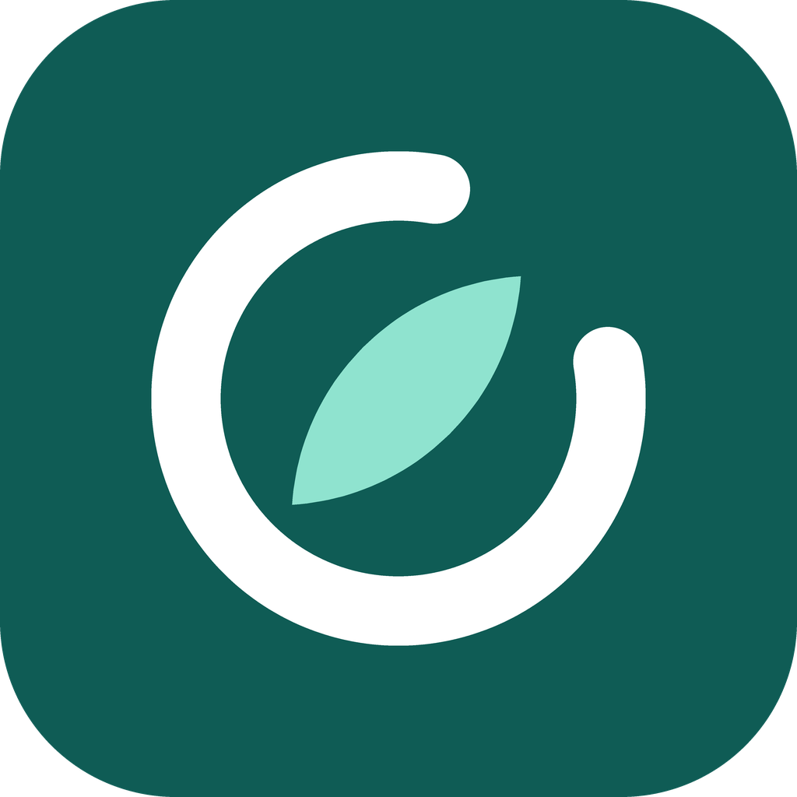

# NeoWell: sağlığın yeni kaynağı

Kişisel diyet ve spor takipçisi.

İnternetsiz çalışan, sadece senin telefonunda duran Android uygulaması. Kilo, su, yemek, spor ve not kaydeder. Salon sekmesinde set, tekrar ve ağırlık takibi, rekorlar ve bir sonraki antrenman için ağırlık önerisi var. Trend sekmesi kilo trendini, gerçek verinden harcamanı ve kalori hedefi önerisini gösterir. Günlük hatırlatma bildirimleri gönderir.

## APK'yı almak (yaklaşık 10 dakika, ücretsiz)

1. https://github.com adresinde hesabın yoksa aç.
2. Sağ üstteki **+** ile **New repository** de. İsim olarak `koc` yaz, **Private** seç ve oluştur.
3. Açılan boş depoda **uploading an existing file** bağlantısına tıkla. Bu klasörün **içindekileri** sürükle (`www`, `scripts`, `signing`, `.github`, `package.json`, `package-lock.json`, `capacitor.config.json`, `.gitignore`, `assets`). Klasörün kendisini değil, içindekileri yükle. `signing` klasöründeki anahtar dosyası güncellemelerin eski verinin üstüne kurulabilmesi için gerekli, bu yüzden depo mutlaka **Private** kalmalı. **Commit changes** de.
   - `.github` gizli klasör olduğu için dosya yöneticisinde görünmeyebilir. Mac'te Cmd+Shift+. ile, Windows'ta Görünüm > Gizli öğeler ile göster. Telefondan yüklüyorsan bunu bilgisayardan yapmak daha rahat.
4. Depoda **Actions** sekmesine geç. "APK derle" çalışmaya başlamış olmalı. Başlamadıysa soldan **APK derle**, sonra **Run workflow** de. Yaklaşık 5 dakika sürer, yanında yeşil tik çıkınca bitmiştir.
5. Telefonunun tarayıcısında deponun ana sayfasına git, sağdaki **Releases** bölümünden **NeoWell APK (son sürüm)** e gir ve `neowell.apk` dosyasını indir. (Depo Private olduğu için GitHub'a giriş yapman istenir.)
6. İndirilen dosyaya dokun. Android "bilinmeyen kaynaklardan yükleme" izni isteyecek, bu uygulama için izin ver ve kur. Google Play Protect "uygulama taranmadı" uyarısı gösterirse **Yine de yükle** de, uygulamayı sen derledin.
7. İlk açılışta bildirim iznini onayla.

## Koçu açmak (API anahtarı girmek)

Koç, ücretsiz yapay zekâ servislerinden birine bağlanır. Uygulamada Ayarlar > **Yapay zekâ koç** bölümünde NVIDIA Build, Groq ve OpenRouter hazır gelir. Sırayla denenir, biri limite takılırsa sıradaki devreye girer.

1. Anahtar al (hepsi ücretsiz hesapla):
   - NVIDIA Build: https://build.nvidia.com (hesap aç, bir modelin sayfasında **Get API Key**)
   - Groq: https://console.groq.com (**API Keys**)
   - OpenRouter: https://openrouter.ai (**Keys**)
2. Uygulamada Ayarlar'da sağlayıcıya dokun, **API anahtarı** alanına yapıştır, **Kaydet**, sonra **Bağlantıyı test et**.
3. Test "Çalışıyor" derse Koç sekmesine geç. İlk seferde veri paylaşımı onayı çıkar.

Notlar:
- Anahtarlar yalnızca telefonda durur, uygulamanın yedek metnine girmez. Android'in kendi bulut yedeği açıksa telefon verisiyle birlikte Google hesabına yedeklenebilir.
- Model adları ve ücretsiz limitler zamanla değişir. Test hata verirse **Modelleri getir** ile listeden güncel bir model seç.
- Google Gemini kapalı gelir, çünkü ücretsiz katmanda istemler ürün geliştirmek için kullanılabilir. Açarsan her göndermeden önce onay ister.
- 18 yaş altı, sağlık notu girilmiş ya da BMI'si düşük kullanıcılara kalori açığı önerilmez; öneri bakım düzeyinde kalır.
- Koç hekim değildir. Baş dönmesi, göğüs ağrısı gibi belirtilerde uygulama kendi güvenlik kartını gösterir ve 112'yi önerir.
- Su, kilo, yemek, spor ve salon kayıtları internet ve anahtar olmadan çalışmaya devam eder.

## Güncelleme

`www/index.html` dosyasını GitHub'da düzenleyip kaydettiğin her seferde APK kendiliğinden yeniden derlenir. Her derleme aynı imza anahtarıyla yapıldığı için yeni APK'yı eskisinin üstüne kurabilirsin, veriler silinmez. Yine de güncellemeden önce Ayarlar'dan yedek al.

**Önemli:** Bu düzeltmeden önce kurduğun bir sürüm varsa, onun imzası farklıdır. Android üstüne kurmaya izin vermez. Bir kereliğine eski uygulamayı sil (önce yedek al), yenisini kur, yedeği geri yükle. Bundan sonraki güncellemeler sorunsuz olur.

## Bilmen gerekenler

- Veriler yalnızca telefonda durur. Uygulamayı silersen kaybolur. Ayarlar > **Yedekle veya geri yükle** ile yedeği dosya olarak paylaş (Drive, WhatsApp, e-posta) ya da metni kopyala. Geri yüklerken **Dosyadan oku** ile dosyayı seçebilirsin. Parola yazarsan yedek şifrelenir ve API anahtarların da içine girer (telefon değiştirirken işe yarar). Parolayı unutursan yedek açılmaz. 14 günden uzun süredir yedek dosyası almadıysan Bugün ekranında hatırlatma çıkar. Android'in otomatik yedeği açıksa (telefon ayarlarında Google yedekleme) uygulama verisi ayrıca Google hesabına yedeklenir.
- Hatırlatmalar sabit metinlidir ve uygulama kapalıyken de gelir. Saatleri ve hangilerinin açık olacağını Ayarlar'dan değiştirebilirsin.
- Bildirimler hiç gelmiyorsa telefon ayarlarında NeoWell için bildirim iznini ve pil ayarlarında "kısıtlama yok" seçeneğini kontrol et. Bazı telefonlar (Xiaomi, Huawei, Samsung) arka plan bildirimlerini agresif keser.
- Android 12 ve üstünde hatırlatmaların tam saatinde gelmesi için uygulama "Alarmlar ve hatırlatıcılar" iznini kullanır, kurulumda otomatik verilir. Gelmezse telefon ayarlarından NeoWell > İzinler bölümüne bak.
- Uygulama adı ve paket adı NeoWell (`com.neowell.app`) olarak değişti. Eski "Koç" uygulaması ayrı bir uygulama sayılır: önce eskisinden yedek al, NeoWell'i kur, yedeği geri yükle, sonra eskisini sil. (Yapay zekâ sohbet sekmesinin adı Koç olarak kaldı.)
- Kurulan APK "debug" imzalıdır. Kendi kullanımın için sorun değildir, Play Store'a yüklenemez.

## Bilgisayarda hızlı deneme

`www/index.html` dosyasını tarayıcıda açman yeterli. Bildirimler hariç her şey çalışır.
