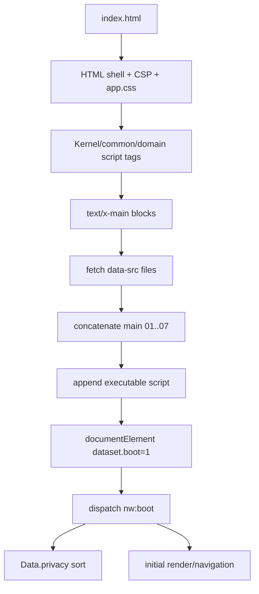

# Faz 1 — yükleme ve boot akışı

## HTML iskeleti

`www/index.html` uygulama kabuğunu kuruyor:

- `#app` altında header ve `#view`
- `nav` altında `today`, `gym`, `trend`, `coach`, `more` tab düğmeleri
- `#composer` adlı rehber giriş bölgesi
- `app.css` stil dosyası
- CSP: `default-src 'self'`, `connect-src 'self' https:`, `object-src 'none'`, `form-action 'none'` (`www/index.html:4-12`)

## Yükleme modeli

1. Kernel, ortak yardımcılar ve domain dosyaları klasik `<script src>` olarak yükleniyor.
2. `main/01-core.js` ile `main/07-actions.js` `type="text/x-main" data-src="..."` bloklarıyla tanımlanıyor.
3. Inline boot kodu bu blokları topluyor, `data-src` değerlerini fetch ediyor, içerikleri birleştiriyor ve yeni bir `<script>` düğümü ekliyor.
4. Ardından `document.documentElement.dataset.boot=1` atanıyor ve `nw:boot` yayınlanıyor (`www/index.html:153-154`).

## Boot sırası açısından önemli bulgu

Ana kodun fetch edilip tek parça olarak çalıştırılması, `main/01-core.js`–`07-actions.js` sırasını koruyan ancak bu dosyaları fiziksel HTML script tag'lerinden ayıran bir yükleme katmanı oluşturuyor. Başarısız fetch veya script üretimi için kullanıcıya görünen kurtarma akışı bu fazda doğrulanmadı.

## `nw:boot` sözleşmesi

`www/kernel/kernel.js:13` `nw:boot` olayında `Data.privacy` listesini sıralıyor. `www/index.html:154` olayın `S` ve render hazır olduktan sonra yayınlandığını belirtiyor. Bu nedenle `nw:boot`, yalnızca DOM hazır olayı değil, uygulama state/render hazırlık bariyeri olarak kullanılıyor.

## Script sırası gözlemi

Ana modül kategorileri ve HTML'deki script kaynak sayıları:

| Kategori | Script sayısı |
|---|---:|
| `gym` | 16 |
| `data` | 13 |
| `insights` | 12 |
| `nutrition` | 9 |
| `habits` | 6 |
| `meds` | 5 |
| `motion` | 5 |
| `log` | 5 |
| `pulse` | 4 |
| `coach` | 4 |
| `labs` | 3 |
| `vitals` | 3 |
| `cycle` | 3 |
| `measures` | 2 |
| `history` | 2 |

## Boot diyagramı

## Sonraki doğrulama

- Fetch hata yolunu test etmek
- Her scriptin tanımladığı global sembolleri çıkarmak
- `nw:boot` dinleyicilerinin tam listesini çıkarmak
- Boot sırasında storage/native başlangıç sırasını izlemek
