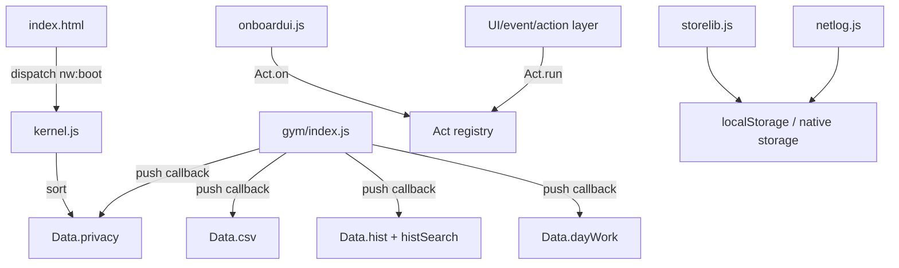

# Faz 2 — ilk haberleşme yüzeyi

Bu belge tam ağ değil; sonraki fazların tarama hedeflerini ve kanıtlanmış ilk bağlantıları kaydeder.

## Kanıtlanmış kanallar

### 1. Script yükleme

`www/index.html` önce kernel/domain scriptlerini, sonra `main/01-core.js`–`07-actions.js` dosyalarını yükler. Main dosyaları `data-src` ile fetch edilip tek script olarak çalıştırılır. Bu, modül → modül iletişiminde global tanımlar ve yükleme sırasını mimari bağımlılık haline getirir.

### 2. `nw:boot`

- Yayınlayan: `www/index.html:154`
- Dinleyen: `www/kernel/kernel.js:13`
- İşlem: `Data.privacy` sıralaması
- Anlam: state ve render hazır bariyeri

### 3. `Data` registry

- Tanım: `www/kernel/kernel.js:10`
- İlk somut üretici: `www/modules/gym/index.js`
- Tüketim/aggregation noktaları: main/data/history/privacy/CSV akışlarında aranacak

### 4. Action registry

- Tanım ve dispatcher: `www/kernel/kernel.js:3-8`
- Onboarding kayıtları: `www/modules/data/onboardui.js:137-148`
- `Act.run` çağrı noktalarının gerçek payload zinciri Faz 3'te çıkarılacak

### 5. Storage

- Güvenli yardımcılar: `www/kernel/ls.js:3-5`
- State store: `www/kernel/storelib.js`
- Network log da localStorage kullanıyor: `www/kernel/netlog.js:6-18`

## İlk doğrudan bağlantı örnekleri

## Açık analiz soruları

- `Data.privacy`, `Data.csv`, `Data.hist` ve `Data.day*` listelerini hangi dosyalar tüketiyor?
- `S` state nesnesinin tüm yazıcıları kimler?
- `save()` hangi veri modelini hangi storage anahtarına yazıyor?
- `data-act` ile `Act.run` arasında doğrudan veya dolaylı eşleşme var mı?
- `nw:boot` dinleyicilerinin tamamı ne yapıyor?
- Native plugin çağrılarının JS tarafındaki tüm çağıranları hangileri?
- `netlog` hangi URL/host bilgilerini ve hangi kişisel verileri tutabiliyor?

## Faz 3 giriş listesi

1. `Data.*` tüm push/okuma/temizleme noktalarını çıkar.
2. `addEventListener` ve `dispatchEvent` çiftlerini çıkar.
3. `data-act`, `data-tab`, `data-g` ve diğer davranış selector'larını eşleştir.
4. Global `S`, `Log`, `Icons`, `Act`, `Data`, `Capacitor` erişimlerini dosya:satır ile listele.
5. Storage anahtarlarını literal ve üretim fonksiyonlarıyla çıkar.
6. Sonuçları `action-network.md`, `event-network.md`, `global-state-map.md`, `storage-map.md` içine işle.
