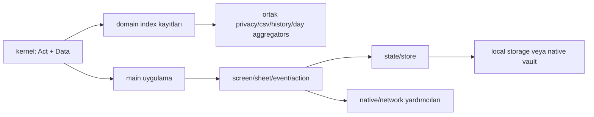

# Faz 2 — modül envanteri ve ilk iletişim yüzeyi

## Modül kategorileri

`www/modules/` altında 12 klasörde `index.js` bulundu:

| Modül | Görülen sorumluluk sinyali |
|---|---|
| `coach` | Rehber sohbeti, provider/chat gizlilik kaydı, coach state erişimi |
| `cycle` | Döngü kayıtları, rapor üretimi, gizlilik temizliği |
| `gym` | Antrenman, CSV, history, gün özeti, egzersiz UI ve import |
| `habits` | Alışkanlık/Ramazan akışları |
| `labs` | Laboratuvar veri ve UI akışları |
| `log` | Günlük kayıtları, içecek ve log girdileri |
| `measures` | Ölçüm ekranı ve veri bağlantıları |
| `meds` | İlaç veri/UI, ilaç alarm bağlantıları |
| `motion` | Adım/hareket UI ve cihaz hareket verisi |
| `nutrition` | Gıda, öğün ve beslenme hesapları |
| `pulse` | Nabız/pulse akışları |
| `vitals` | Vital ölçüm mantığı ve UI |

Bu tablo klasör adından değil, `index.js` içindeki kayıt ve kullanılan sembollerden çıkarılmış ilk sınıflandırmadır. Ayrıntılı public API ve veri sahipliği Faz 3-4'te çıkarılacak.

## Kernel katmanı

Görülen kernel dosyaları:

- `kernel.js` — `Act` action registry ve `Data` registry (`www/kernel/kernel.js:1-14`)
- `common.js` — ortak metin ve satır yardımcıları
- `ls.js` — güvenli localStorage yardımcıları ve native key vault arayüzü
- `storelib.js` — state store ve transaction/fallback katmanı
- `netlog.js` — network çağrı/log katmanı
- `share.js` — paylaşım ve boot sonrası temizlik bağlantıları
- `algo.js`, `unitui.js` ve diğer kernel yardımcıları

## Ana uygulama katmanı

- `main/01-core.js` — temel yardımcılar ve uygulama günü mantığı
- `main/02-state-components.js` — state bileşenleri
- `main/03-screens.js` — ekranlar
- `main/04-sheets.js` — sheet/modal akışları
- `main/05-notifications.js` — bildirimler
- `main/05-permissions.js` — izinler
- `main/06-events.js` — event kayıtları
- `main/07-actions.js` — action davranışları

## Action yüzeyi

Statik taramada:

- `Act.on`: 3 kayıt
- `Act.onPre`: 0 kayıt
- `Act.run`: 1 doğrudan kullanım

Görülen action kayıtları:

| Action | Dosya | Davranış |
|---|---|---|
| `obmods` | `www/modules/data/onboardui.js:137` | Onboarding modül seçme sheet'i açar |
| `obmodsno` | `www/modules/data/onboardui.js:139` | Onboarding modül seçimini kapalı işaretler, kaydeder ve render eder |
| `obredo` | `www/modules/data/onboardui.js:148` | Onboarding akışını başlangıç adımına döndürür |

Bu sonuç, `Act` registry'nin tüm uygulama iletişiminin ana kanalı olmadığını gösteriyor. `data-*`, click delegation, global state, doğrudan fonksiyon ve storage kanalları ayrıca çıkarılmalı.

## Data registry yüzeyi

`Data` şu listeleri tanımlıyor (`www/kernel/kernel.js:10`):

```text
privacy, csv, csvEntries, hist, histSearch, dayRows, dayWork
```

İlk görülen kullanım örneği `gym/index.js` içindedir:

- `Data.privacy` içine antrenman sayısı/temizleme kaydı ekler
- `Data.csv` içine antrenman CSV sağlayıcısı ekler
- `Data.hist` içine history sağlayıcısı ekler
- `Data.histSearch` içine arama sağlayıcısı ekler
- `Data.dayWork` içine gün özeti sağlayıcısı ekler

Bu registry, domain modüllerinin birbirini doğrudan çağırmak yerine ortak aggregating kernel listelerine kayıt olmasını sağlayan önemli bir haberleşme mekanizmasıdır.

## İlk bağımlılık modeli



## İlk mimari riskler

1. **Script sırası bağımlılığı:** Klasik global script yükleme, modül tanımlarının sırasını önemli kılıyor.
2. **Registry sözleşmesi:** `Data` listelerine farklı modüller farklı callback biçimleri ekliyor; callback sözleşmeleri ayrıca belgelenmeli.
3. **Geniş ana dosyalar:** `gym.js` ve `coach.js` gibi dosyalar yüksek davranış yoğunluğu taşıyor.
4. **Action kanalının sınırlı görünmesi:** Gerçek iletişimin çoğu henüz haritalanmamış global/event/storage yollarında olabilir.
5. **Native sınırı:** `ls.js`, `netlog.js` ve çeşitli UI modülleri storage/network/native sınırlarına bağlanıyor; veri akışı Faz 4-6'da izlenmeli.

## Bu fazın sonucu

İlk modül listesi ve iletişim yüzeyi çıkarıldı. Tam ağ grafiği üretmek için sonraki fazda `addEventListener`, `dispatchEvent`, `data-act`, global semboller, storage anahtarları ve `Data.*` kayıtlarının tanımlayan/okuyan/yazan dosyalarla eşleştirilmesi gerekiyor.
